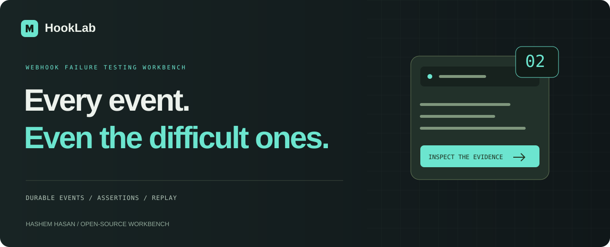
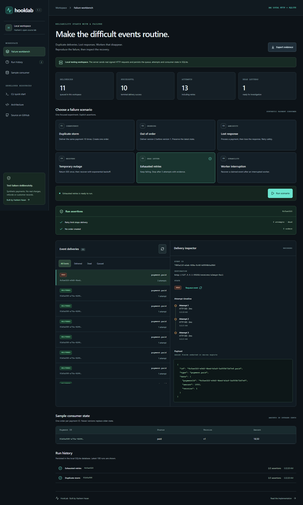

<p align="center"></p>
<p align="center"><a href="https://hashem-hasan.github.io/hooklab/"><strong>Try the browser simulation ↗</strong></a> · <a href="#quick-start">Run real HTTP tests</a> · <a href="docs/architecture.md">Architecture</a> · <a href="examples/payment.json">Example event</a></p>
<p align="center"><a href="https://github.com/Hashem-Hasan/hooklab/actions/workflows/ci.yml"></a>   <a href="LICENSE"></a></p>

# Make the difficult events routine.

Deliver the same payment ten times. Lose the response after processing it. Send cancellation before payment. Interrupt a claimed event and reopen the database.

**HookLab is a local webhook failure-testing workbench** with signed HTTP requests, a durable SQLite queue, an idempotent sample consumer and assertions you can inspect. It gives failure cases a repeatable home before you bring them to a production integration.



## Six focused experiments

| Scenario            | What actually happens in local server mode                                                                     | Assertion                                           |
| ------------------- | -------------------------------------------------------------------------------------------------------------- | --------------------------------------------------- |
| Duplicate storm     | Ten HTTP deliveries share a provider event ID                                                                  | One inbox receipt and one order                     |
| Out of order        | Version 2 cancellation arrives before version 1 payment                                                        | Latest version and cancelled state survive          |
| Lost response       | Receiver commits, then delays its response past the sender timeout                                             | Retry succeeds without another order                |
| Temporary outage    | Receiver returns 503 once                                                                                      | Backoff and a later attempt succeed                 |
| Exhausted retries   | Receiver keeps returning 503                                                                                   | Event enters dead-letter state after three attempts |
| Worker interruption | Scenario recovers an intentionally claimed event; integration test also closes and reopens the actual database | Recovery preserves one order and completes delivery |

The **public GitHub Pages demo is explicitly an in-memory simulation**. It uses the shared payment reducer but makes no HTTP calls, retains no state after refresh and reports no measured network latency. Start the local server for real HTTP delivery and persistence.

## Quick start

Use **Node 24.14+**. Node's built-in SQLite API is experimental in this release; pin your runtime for repeatable testing.

```bash
git clone https://github.com/Hashem-Hasan/hooklab.git
cd hooklab
npm ci
npm start
```

`npm ci` prepares the compiled CLI and production dashboard. Open **http://127.0.0.1:4202**. Choose a scenario and run it. Expand an event's history, inspect the payload, review assertions and export the redacted evidence snapshot.

The server binds to `127.0.0.1`. SQLite state lives in `.data/hooklab.sqlite` with WAL sidecars. Keep the entire database directory on persistent local disk. It is gitignored.

### CLI

Keep the server running in one terminal:

```bash
npm run cli -- scenario --name duplicates
npm run cli -- scenario --name timeout
npm run cli -- status
npm run cli -- enqueue --file examples/payment.json --target http://127.0.0.1:4202/receiver
```

Other scenario names: `out-of-order`, `retry`, `dead-letter`, `restart`.

```bash
# Customize local port and database path.
npm run cli -- start --port 4302 --db .data/experiment.sqlite

# Point client commands at that server.
npm run cli -- scenario --server http://127.0.0.1:4302 --name duplicates
```

The CLI returns `0` for a successful command with passing assertions, `1` for failed HTTP commands/assertions, and `2` for argument/runtime errors.

### Install directly from GitHub

This project is not published to npm. Install the GitHub source:

```bash
npm install -g github:Hashem-Hasan/hooklab
hooklab start
hooklab scenario --name duplicates
```

The package includes its compiled server and dashboard. Node 24.14+ remains required.

## Test your own receiver

By default, only the workbench's own origin is a valid delivery target. Explicitly allow another trusted test origin before starting the server:

```powershell
$env:HOOKLAB_SECRET = 'replace-with-your-local-test-secret'
$env:HOOKLAB_ALLOWED_ORIGINS = 'http://127.0.0.1:3000'
npm start
```

On Bash, set the same environment variables with `export`. Multiple origins are comma-separated. Restart the server after changing them. Redirects are not followed; URL credentials, query strings and fragments are rejected.

Enqueue a payment-shaped JSON event targeting your allowed receiver. Deliveries carry:

```text
Content-Type: application/json
X-Hooklab-Signature: sha256=<HMAC-SHA256 of the exact request body>
```

Use the configured secret to validate the raw body. This is **HookLab's test protocol**, not an imitation of a provider-specific signing format. No signature timestamp/replay window is included. The sample consumer uses transactional deduplication and version checks; your receiver needs its own appropriate protection.

This release accepts the documented payment event schema: safe provider/payment IDs, nonnegative integer amount in cents, positive integer version and `payment.paid` or `payment.cancelled`. It is not a generic arbitrary-payload webhook gateway.

### Library API

```ts
import { createApp } from '@hashem-hasan/hooklab';

const app = createApp({ filename: '.data/experiment.sqlite', timeoutMs: 800 });
app.server.listen(4202, '127.0.0.1');
// After the server starts:
const result = await app.runScenario('duplicates');
console.log(result.assertions);
await app.close();
```

## How delivery works

1. Validate the event and allowed target, then store the delivery before sending it.
2. Claim a due delivery and increment its attempt count.
3. Send a signed POST with an 800ms default timeout.
4. Persist HTTP status, error class and latency. Successful 2xx completes delivery. Most 4xx responses stop immediately; 408, 429, network failures and other non-2xx responses retry up to three attempts.
5. Use exponential retry delays starting at 100ms, capped for predictable local experiments. Retry-After and jitter are not implemented.
6. On startup, return interrupted `processing` events to the queue. The consumer's inbox receipt and order update commit in one SQLite transaction.

Requeue a dead-letter event in the inspector, then refresh to inspect the new result. Old attempt records remain; the current attempt counter resets for the new cycle. Provider IDs reused with different business data are rejected rather than silently accepted as duplicates.

## Engineering evidence

```bash
npx playwright install chromium
npm test
npm run build
npm run test:ui
npm run format:check
npm pack --dry-run
```

Integration tests send real HTTP requests for all six scenarios, reject forged signatures and conflicting IDs, enforce origin/payload limits, verify redaction and reopen the actual database after the consumer commits but the delivery acknowledgement is lost. Production browser tests cover scenario execution, duplicate outcomes, dead letters, evidence download, simulation labeling and 375/768/1440px layouts.

See [architecture and trade-offs](docs/architecture.md). Original screenshots show the running product with synthetic data. Assertions are calculated from recorded state; no customer metrics or adoption claims are implied.

## Operational boundaries

- **Local, single-process test tool.** Run one server/worker per database. Multiple processes are not supported. Startup recovery assumes no other worker owns an active claim.
- **At-least-once delivery.** A receiver can commit before the sender sees success. Exactly-once network delivery is not claimed; idempotent consumer transactions prevent repeated sample side effects.
- **Local security boundary.** There is no user login or multi-tenant isolation. Keep loopback binding; do not expose it through a public proxy. The API checks Host and browser Origin on mutations. Origin checks do not authenticate local processes.
- **Sensitive data.** Payloads are stored unencrypted for replay. API snapshots recursively redact fields matching secret/token/password/authorization/API-key names; redaction cannot identify arbitrary PII in other fields. Use synthetic data and protect database files.
- **History limits.** UI/API snapshots show the latest 500 deliveries, 2,000 attempts, 500 orders and 100 runs. Displayed metrics refer to that loaded snapshot. Database records are retained until you deliberately remove the test database while the server is stopped; there is no automatic retention policy.
- **Deployment.** GitHub Pages hosts the simulator only. The real workbench needs Node and writable persistent disk. Ephemeral serverless storage is unsuitable.

## Contribute

Add a reproducible failure case, a trustworthy assertion or an improvement to the evidence workflow. Read [CONTRIBUTING.md](CONTRIBUTING.md) and [SECURITY.md](SECURITY.md).

Built by **[Hashem Hasan](https://www.tarneebtech.com/)** · [LinkedIn](https://www.linkedin.com/in/hashem-hasan) · [MIT](LICENSE)

Developed with AI assistance, then reviewed and tested as described above. All example data is synthetic.
