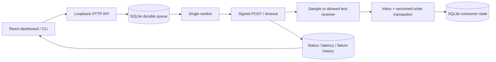

# Delivery, evidence and honest boundaries

## Why this implementation?

- **Built-in SQLite:** an inspectable persistent state machine without Redis, Docker or a paid service. The Node API remains experimental; CI pins Node 24.
- **Actual HTTP tests:** idempotency and timeout ambiguity are observed through the network boundary. The lost-response receiver commits before intentionally delaying its response.
- **Transactional inbox:** a unique provider event ID and canonical business payload are saved with the order change. Retries cannot create a second order. Conflicting reuse of an event ID fails.
- **Versioned consumer:** an older version cannot roll back a cancellation. Equal versions are ignored. A provider must supply trustworthy monotonically increasing versions for this strategy to apply.
- **Explicit queue recovery:** startup requeues claimed events. A real close/reopen test exercises the ambiguous acknowledgement boundary. This design supports one process per database, not distributed leases.
- **Honest public simulator:** static hosting cannot run Node or persist a server queue. The browser adapter is labeled, uses the shared reducer and computes its assertions from simulated state. Its zero latency is never presented as a measurement.

## Storage

`events` contains the immutable delivery payload/target plus current state/counter. `attempts` records completed attempts. `inbox` protects consumer idempotency. `orders` keeps the newest business version. `runs` stores scenario assertions. WAL mode and a busy timeout are enabled. A crash can leave an incremented attempt counter without a completed-attempt record; recovery retries that event. This is intentional evidence of interruption, not a fabricated response.

## Failure model

The sample is designed for transport faults and consumer ordering/deduplication. It does not model distributed consensus, multiple workers, poison-message quarantine beyond dead-letter state, real payment settlement, provider signature formats, arbitrary payload schemas, production retry scheduling or remote authentication. The small backoff windows are useful for experiments, not production defaults.

## Extending safely

Start with a synthetic contract, an allowed origin and assertions. Keep raw signatures and credentials out of logs. Do not claim real-provider correctness until its protocol and sandbox have been tested. Add request IDs, migrations, retention controls and durable leases before considering a multi-worker service.
